<picture>
  <source media="(prefers-color-scheme: dark)" srcset="./assets/header-dark.svg">
  <source media="(prefers-color-scheme: light)" srcset="./assets/header-light.svg">
  
</picture>

 

I build native iOS apps with Swift and SwiftUI, from UI and architecture to backend integration, tests and App Store release. 4th-year student at BSUIR, open to Junior iOS Developer roles and internships.

**Projects:** [Jmix](https://github.com/exth/Jmix), an AI career planner on the App Store · [Puma](https://github.com/exth/Puma), a sneaker shop app

<picture>
  <source media="(prefers-color-scheme: dark)" srcset="./assets/footer-dark.svg">
  <source media="(prefers-color-scheme: light)" srcset="./assets/footer-light.svg">
  
</picture>
